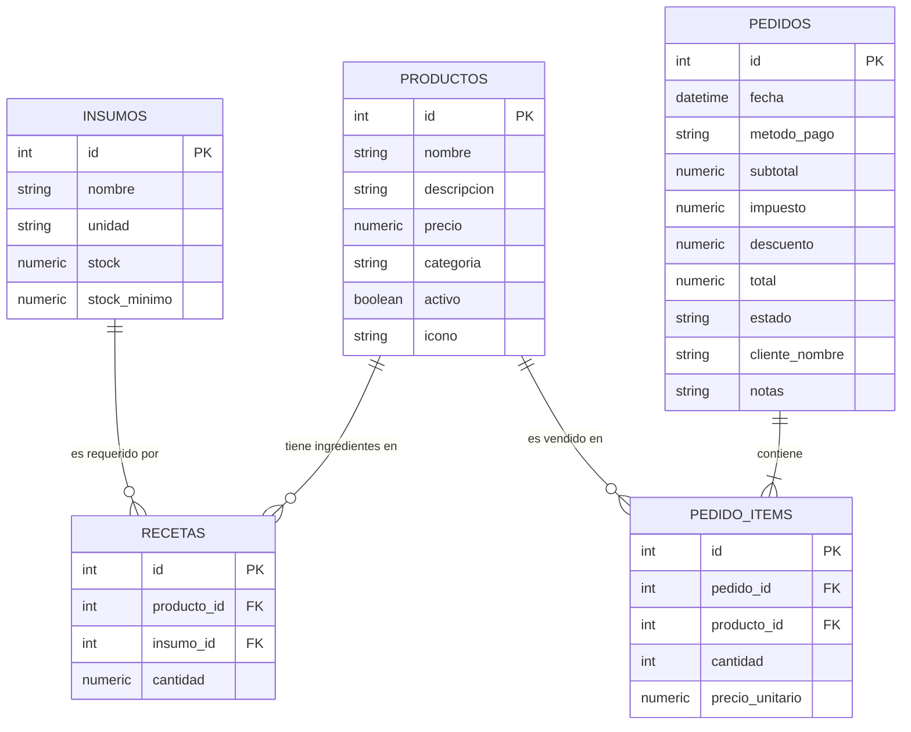

# 🌸 Komorebi Café & Bakery — Laboratorio #2
> **Sistema Integral de Punto de Venta (POS), Control de Inventario por Recetas y Abastecimiento Asistido por Agente de IA (n8n)**  
> **Stack:** React 18 (Vite) · React Router v6 · Node.js + Express · PostgreSQL / SQLite · n8n AI Agent · Asistente IA Copiloto

---

## ☕ 1. Caso de Negocio Elegido
**CASO 1: Punto de venta e inventario de una cafetería**  
* **Dominio:** Comercio / Ventas / Gastronomía Gourmet  
* **Identidad de Marca:** *Komorebi Café & Bakery* — Cafetería de especialidad con estética *cute / pastel* (tonos café moca, fresa, crema y matcha), orientada a la experiencia de usuario amigable y rigurosidad técnica en el servidor.
* **Problema que resuelve:**  
  A diferencia de un inventario simple por producto, la cafetería controla su stock a nivel de **materia prima (insumos)**. Cada producto del menú (bebidas calientes, cafés fríos, mochis, croissants) se compone de una **receta** con cantidades específicas (gramos de café, mililitros de leche, vasos, servilletas). El sistema garantiza que:
  - No se puedan ordenar productos si no hay insumos suficientes (**HTTP 409 Conflict**).
  - Cada venta descuenta los insumos dentro de una **transacción atómica (ACID)**.
  - Los pedidos solo pueden cancelarse en los **primeros 15 minutos**, reintegrando los insumos al inventario.
  - Cierre de caja diario por método de pago y ranking de los 5 productos más vendidos calculados con **SQL (SUM, COUNT, GROUP BY)**.
  - Un **Agente de IA en n8n** analiza los insumos críticos con bajo stock frente al ritmo de ventas y redacta una sugerencia de compra matemáticamente justificada.
  - **Reto Extra implementado:** Detección automática de **Combos Café + Repostería** con **10% de descuento** sobre los productos combinados.

---

## 🗄️ 2. Diagrama Entidad-Relación (ER)



---

## 📂 3. Estructura del Repositorio

El proyecto sigue una arquitectura limpia dividida por responsabilidades y capas:

```text
Laboratorio 2/
├── schema.sql                 # Esquema relacional DDL + Seed data para PostgreSQL / SQLite
├── BITACORA_IA.md             # Registro de 5 prompts estructurados, respuestas y ajustes
├── README.md                  # Documentación completa y guía de defensa
├── postman_collection.json    # Colección de pruebas para Postman / Thunder Client (200, 201, 400, 404, 409)
├── n8n_workflow.json          # Workflow de n8n exportado sin credenciales
├── n8n/
│   └── workflow_sugerencia_compras.json
├── backend/                   # API REST en Node.js + Express
│   ├── .env.example           # Plantilla de variables de entorno
│   ├── .env                   # Configuración de puerto y motor DB (sqlite / postgres)
│   ├── package.json
│   ├── test-api.js            # Suite automatizada de 16 pruebas con 100% de cobertura
│   └── src/
│       ├── db.js              # Capa de conexión (Pool pg o SQLite integrado en Node 22+)
│       ├── initDb.js          # Inicializador y sembrador automático de la base de datos
│       ├── app.js             # Configuración de Express, CORS y middleware global
│       ├── server.js          # Arranque del servidor HTTP
│       ├── routes/            # Definición de rutas REST por recurso
│       │   ├── insumosRoutes.js
│       │   ├── productosRoutes.js
│       │   ├── pedidosRoutes.js
│       │   ├── resumenRoutes.js
│       │   └── iaRoutes.js
│       ├── controllers/       # Controladores que reciben peticiones y emiten códigos HTTP
│       │   ├── insumosController.js
│       │   ├── productosController.js
│       │   ├── pedidosController.js
│       │   ├── resumenController.js
│       │   └── iaController.js
│       └── services/          # Reglas de negocio y consultas SQL parametrizadas
│           ├── insumosService.js
│           ├── productosService.js
│           ├── pedidosService.js
│           ├── resumenService.js
│           └── iaService.js
└── frontend/                  # Interfaz de usuario React + Vite
    ├── package.json
    ├── vite.config.js
    ├── index.html
    └── src/
        ├── index.css          # Sistema de diseño Cafetería Cute (colores pastel, tarjetas, badges)
        ├── App.jsx            # Enrutador principal con React Router
        ├── main.jsx
        ├── services/
        │   └── api.js         # Capa cliente centralizada para todos los endpoints
        ├── hooks/
        │   └── useFetch.js    # Custom Hook con estados data, loading, error y refetch
        ├── components/        # Componentes reutilizables
        │   ├── Navbar.jsx
        │   ├── MetricCard.jsx
        │   ├── ErrorMessage.jsx
        │   ├── Modal.jsx
        │   └── Badge.jsx
        └── views/             # Vistas de la aplicación
            ├── POSView.jsx           # Catálogo, carrito, cálculo 13% IVA y combos
            ├── PedidosView.jsx       # Historial, búsqueda, detalle y anulación a 15 min
            ├── InventarioView.jsx    # CRUD de insumos, bajo stock y visor de recetas
            ├── MetricasView.jsx      # Panel de cierre de caja y Top 5 más vendidos
            └── IAAssistantView.jsx   # Agente de IA n8n y sugerencia de abastecimiento
```

---

## 🚀 4. Guía de Instalación y Ejecución

### Prerrequisitos
- **Node.js**: v18.0.0 o superior (recomendado v22+ o v24).
- **npm**: v9.0.0 o superior.
- **Base de Datos**: 
  - *Opción A (Recomendada para ejecución instantánea)*: SQLite nativo (no requiere instalar nada; ya viene preconfigurado y se auto-inicializa).
  - *Opción B*: PostgreSQL (crear base `createdb cafeteria_db` y cargar `psql -d cafeteria_db -f schema.sql`).

---

### Paso 1: Levantar el Backend (API)

```bash
# Entrar a la carpeta backend
cd backend

# Instalar dependencias (express, cors, dotenv, pg, nodemon)
npm install

# (Opcional) Inicializar o resetear la base de datos con datos de semilla
npm run init-db

# Iniciar el servidor API en modo desarrollo (puerto 3001)
npm run dev
# o en modo producción:
npm start
```

> **Verificación:** La API responderá en `http://localhost:3001`. Puedes ingresar a `http://localhost:3001/` para comprobar su estado de salud.

#### Ejecutar Suite de Pruebas Automatizadas del Backend:
En cualquier momento puedes verificar que todos los códigos HTTP y reglas de negocio funcionen ejecutando:
```bash
cd backend
npm run test-api
```
*(Verificará 16 pruebas pasando 100%: códigos 200, 201, 400, 404, 409, transacciones y 13% impuesto).*

---

### Paso 2: Levantar el Frontend (React + Vite)

Abre una **segunda terminal**:

```bash
# Entrar a la carpeta frontend
cd frontend

# Instalar dependencias
npm install

# Iniciar servidor de desarrollo de Vite
npm run dev
```

> **Acceso:** Abre tu navegador web en **`http://localhost:5173`** para disfrutar de la experiencia Cute Café.

---

### Paso 3: Configurar el Agente de IA en n8n (Opcional para flujo en vivo)

El backend cuenta con **doble modalidad de agente de IA**:
1. **Modo Live n8n**: Si n8n está encendido en el puerto 5678, envía el payload al Webhook y recibe la respuesta del LLM.
2. **Modo Fallback Heurístico Transparente**: Si n8n no está ejecutándose, el backend genera la sugerencia de compra con idéntico contrato `{ ok, data, error }`, calculando el déficit y justificando las compras. Esto garantiza que tu demo nunca falle.

#### Para importar el workflow en n8n:
1. Inicia n8n en tu computadora (`npx n8n`).
2. Ve a **Workflows > Import from File** y selecciona el archivo `n8n/workflow_sugerencia_compras.json` (o `n8n_workflow.json`).
3. En el nodo *OpenAI Chat Model*, conecta tu API Key de OpenAI (o cambia el nodo por Anthropic Claude / Google Gemini si lo prefieres).
4. Activa el workflow (**Active: ON**).
5. El webhook estará escuchando en `http://localhost:5678/webhook/sugerencia-compras`.

---

## 📡 5. Catálogo Exhaustivo de Endpoints REST

| Método | Endpoint | Descripción | Códigos HTTP |
| :--- | :--- | :--- | :--- |
| `GET` | `/` | Información de la API y estado de salud | `200` |
| `GET` | `/api/resumen` | Cierre de caja, ingresos, métricas SQL (`SUM`, `COUNT`, `GROUP BY`) | `200` |
| `GET` | `/api/productos` | Catálogo de productos con disponibilidad calculada según recetas | `200` |
| `GET` | `/api/productos/:id` | Detalle del producto con sus ingredientes y receta completa | `200`, `404` |
| `POST` | `/api/productos` | Crea un producto en el menú | `201`, `400` |
| `PUT` | `/api/productos/:id` | Actualiza precio o datos del producto | `200`, `400`, `404` |
| `DELETE` | `/api/productos/:id` | Desactiva o elimina el producto si no tiene órdenes | `200`, `404` |
| `GET` | `/api/insumos` | Lista insumos con bandera de bajo stock (`stock <= stock_minimo`) | `200` |
| `GET` | `/api/insumos/:id` | Insumo por ID y productos donde es utilizado | `200`, `404` |
| `POST` | `/api/insumos` | Crea materia prima (valida nombre, unidad y stock >= 0) | `201`, `400` |
| `PUT` | `/api/insumos/:id` | Modifica existencias o niveles mínimos | `200`, `400`, `404` |
| `PATCH` | `/api/insumos/:id/stock` | Ajuste rápido (+ / -) de existencias | `200`, `400`, `404` |
| `DELETE` | `/api/insumos/:id` | Elimina insumo (**409 si está asignado a recetas activas**) | `200`, `404`, `409` |
| `GET` | `/api/pedidos` | Historial de órdenes con filtros de estado y cálculo de anulación | `200` |
| `GET` | `/api/pedidos/:id` | Detalle de orden con items y precios unitarios históricos | `200`, `404` |
| `POST` | `/api/pedidos` | Crea orden (**transacción ACID**, descuenta stock, aplica 13% IVA) | `201`, `400`, `409` |
| `PATCH` | `/api/pedidos/:id/anular` | Anula orden en los primeros 15 min y reintegra insumos (**transacción**) | `200`, `404`, `409` |
| `POST` | `/api/ia/sugerencia-compras` | Agente IA que analiza bajo stock y ventas semanales | `200` (`{ ok, data, error }`) |

---

## ⚖️ 6. Reglas de Negocio Implementadas y Dónde Viven

| Regla del Caso | Explicación Técnica | Archivo Servidor | Código HTTP |
| :--- | :--- | :--- | :--- |
| **Cálculo de Precios e Impuesto del 13%** | El precio **nunca se toma del cliente**; se lee de la BD. Se calcula `impuesto = subtotal * 0.13` y se guarda `precio_unitario` en `pedido_items` para preservar el histórico de precios ante futuras subidas. | [`backend/src/services/pedidosService.js`](file:///c:/Users/Fwd%20Costa%20Rica/Downloads/Laboratorio%202/backend/src/services/pedidosService.js) | `201` |
| **Validación de Disponibilidad de Receta** | Antes de crear la orden, el servidor calcula los insumos totales de todas las recetas. Si algún insumo no alcanza, rechaza de inmediato con el desglose exacto de lo faltante. | [`backend/src/services/pedidosService.js`](file:///c:/Users/Fwd%20Costa%20Rica/Downloads/Laboratorio%202/backend/src/services/pedidosService.js#L140-L165) | `409 Conflict` |
| **Transacción Atómica de Venta** | Todo el proceso de inserción del pedido, inserción de sus items y descuento de inventario se ejecuta entre `BEGIN` y `COMMIT`. Si algo falla, se ejecuta `ROLLBACK`. | [`backend/src/services/pedidosService.js`](file:///c:/Users/Fwd%20Costa%20Rica/Downloads/Laboratorio%202/backend/src/services/pedidosService.js#L185-L235) | `201` / `500` |
| **Límite de 15 Minutos para Anulaciones** | Si han transcurrido más de 15 minutos desde la fecha de emisión del pedido, el servidor rechaza con 409 indicando el tiempo transcurrido. | [`backend/src/services/pedidosService.js`](file:///c:/Users/Fwd%20Costa%20Rica/Downloads/Laboratorio%202/backend/src/services/pedidosService.js#L240-L265) | `409 Conflict` |
| **Reintegro de Insumos al Anular** | Si la anulación es válida (<15 min), dentro de una transacción se consultan las recetas y se hace `UPDATE insumos SET stock = stock + cantidad` de forma atómica. | [`backend/src/services/pedidosService.js`](file:///c:/Users/Fwd%20Costa%20Rica/Downloads/Laboratorio%202/backend/src/services/pedidosService.js#L266-L300) | `200 OK` |
| **Integridad Referencial en Insumos** | No se puede eliminar un insumo si está siendo utilizado por recetas de productos activos. | [`backend/src/services/insumosService.js`](file:///c:/Users/Fwd%20Costa%20Rica/Downloads/Laboratorio%202/backend/src/services/insumosService.js#L125-L140) | `409 Conflict` |
| **Cierre de Caja con SQL Agregado** | Las ventas por método de pago y el Top 5 de productos se calculan directamente en el motor de base de datos usando `SUM()`, `COUNT()` y `GROUP BY`. | [`backend/src/services/resumenService.js`](file:///c:/Users/Fwd%20Costa%20Rica/Downloads/Laboratorio%202/backend/src/services/resumenService.js#L1-L60) | `200 OK` |
| **Reto Extra: Detección Automática de Combos** | Si la orden contiene al menos un café/bebida y un producto de repostería, se aplica automáticamente un 10% de descuento sobre el subtotal antes del IVA. | [`backend/src/services/pedidosService.js`](file:///c:/Users/Fwd%20Costa%20Rica/Downloads/Laboratorio%202/backend/src/services/pedidosService.js#L166-L180) | `201 Created` |

---

## 🎨 7. Vistas del Frontend en React

1. **Punto de Venta (POS) (`/`)**:
   - Catálogo visual interactivo con tarjetas cute (íconos, descripción, precio y estado de disponibilidad calculado según insumos).
   - Filtro por categorías y buscador reactivo.
   - Carrito lateral con cálculo automático de subtotal, descuento por combo, impuesto del 13% y total.
   - Selección de método de pago y envío con feedback inmediato.
2. **Historial de Pedidos (`/pedidos`)**:
   - Tabla y lista con búsqueda por ID o cliente, filtros por estado (Confirmado / Anulado) y método de pago.
   - Ordenamiento dinámico por fecha o monto total.
   - Visor de detalle (modal) con desglose de items y precios históricos.
   - Botón de anulación con temporizador en vivo de los 15 minutos y manejo visual del error 409 si expira.
3. **Inventario & Insumos (`/inventario`)**:
   - Control de materias primas con alertas visuales de bajo stock.
   - Reabastecimiento rápido con modal.
   - Formulario controlado para crear y editar insumos con validación en cliente y servidor.
   - Pestaña de Explorador de Recetas para verificar los ingredientes requeridos por porción de cada producto.
4. **Cierre de Caja & Métricas (`/metricas`)**:
   - Consumo del endpoint `/api/resumen`.
   - Tarjetas de ingresos totales, órdenes atendidas, recaudación de IVA 13% y ahorro en combos.
   - Gráfico de barras visual para el cierre de caja por método de pago.
   - Podio de los Top 5 productos más vendidos.
5. **Agente de IA (n8n) (`/asistente-ia`)**:
   - Asistente virtual barista.
   - Botón de ejecución del análisis de abastecimiento.
   - Diagnóstico ejecutivo y recomendaciones justificadas con nivel de urgencia.
   - Botón para ingresar directamente las compras sugeridas al inventario.
   - Modal con el contrato JSON y descarga del archivo de workflow de n8n.

---

## 🎯 8. Guía para la Demo y Defensa Individual

Cuando el docente evalúe tu laboratorio, puedes demostrar las siguientes secuencias para obtener la máxima nota:

1. **Demostración del CRUD y Disponibilidad Dinámica:**
   - En la vista **Inventario**, muestra un insumo como *Puré Artesanal de Fresa* o *Té Matcha*.
   - Muestra cómo al agotarse o quedar por debajo de lo necesario para una receta, el producto asociado en el **Punto de Venta** cambia automáticamente su badge a *"Sin Insumos"* y se desactiva.
2. **Demostración de Transacción y Error 409 por Insumos:**
   - Abre el **Punto de Venta** o realiza un `POST /api/pedidos` intentando ordenar 500 unidades de Matcha Latte.
   - Señala en pantalla el mensaje de error **HTTP 409 Conflict**: *"No se puede preparar el pedido por falta de insumos suficientes..."*.
   - Explica que el servidor no descontó nada porque la transacción hizo `ROLLBACK`.
3. **Demostración de Transacción Exitosa con 13% IVA y Descuento Combo:**
   - Crea un pedido con un Cappuccino y un Croissant.
   - Muestra cómo la orden calcula el 10% de descuento del combo, el 13% de impuesto de ley, y descuenta en la base de datos los gramos de café, mililitros de leche, vasos y mantequilla.
4. **Demostración de Anulación Regulada a 15 Minutos:**
   - En **Historial de Pedidos**, anula la orden que acabas de crear (está dentro del margen de 15 min). Verifica que el estado cambia a `ANULADO` y el stock de insumos se devolvió al inventario.
   - Intenta anular la orden #1 o #4 (creadas hace más de 15 minutos en los datos semilla): el servidor responderá con **HTTP 409 Conflict** impidiendo la anulación y explicando el tiempo transcurrido.
5. **Demostración del Agente de IA:**
   - Entra a **Agente IA (n8n)** y pulsa *"Ejecutar Análisis con IA"*.
   - Muestra cómo el modelo analiza los déficits de matcha, caramelo y vasos, calculando las cantidades sugeridas con justificación operativa.
